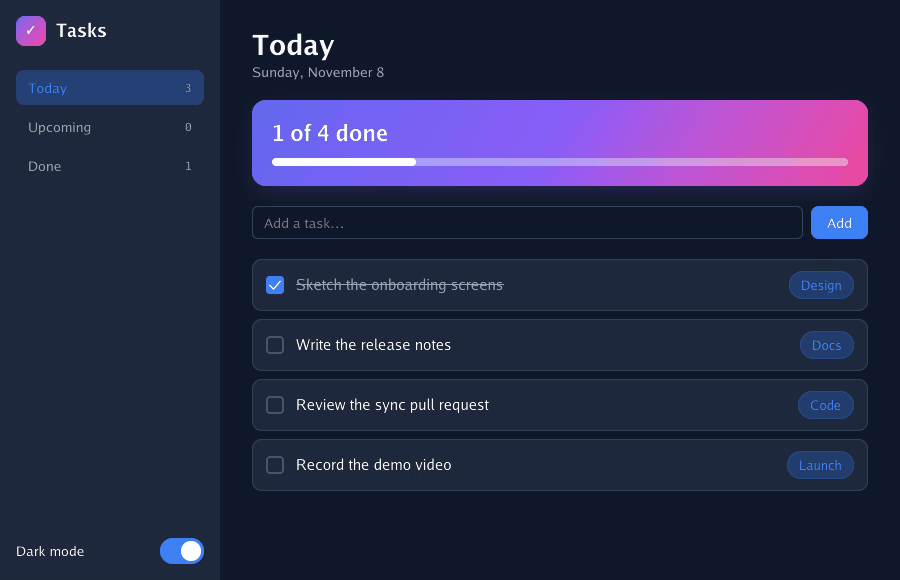

# Giode

[](https://pkg.go.dev/github.com/xmhrnx/giode)
[](https://github.com/xmhrnx/giode/actions/workflows/ci.yml)

<p align="center">
  
</p>

**Giode is CSS-style styling and ready-made components for [Gio](https://gioui.org), Go's GPU-drawn UI toolkit.**
Lay out with flex, gap and padding, then style with radius, gradients, shadows and themes,
all as plain Go structs. You get one native binary for Windows, macOS, Linux, Android, iOS
and the web, with no webview and no JavaScript. Raw Gio stays one call away.

The app above is [`examples/tour`](examples/tour/main.go), about 150 lines. The
[14 apps built with Giode](#apps-built-with-giode) are ready to download.

```go
package main

import (
	"fmt"

	"github.com/xmhrnx/giode"
)

func main() {
	count := 0
	button := giode.Button("Click me", giode.Styles{Background: "#3b82f6", BorderRadius: 8}).
		OnClick(func() { count++ })

	app := giode.New(giode.Config{Title: "Hello", Background: "theme.background"})
	app.Run(func() giode.Element { // runs every frame: build the UI from the current state
		return giode.Stack(giode.Styles{Width: -1, Height: -1, Gap: 12,
			Align: giode.AlignCenter, Justify: giode.JustifyCenter},
			giode.Text(fmt.Sprintf("Clicked %d times", count), giode.Styles{FontSize: 20, Color: "theme.text"}),
			button,
		)
	})
}
```

## How it compares

|  | **Giode** | **Gio** | **Fyne** | **Wails** |
| --- | --- | --- | --- | --- |
| Drawing | Gio, on the GPU | On the GPU | Its own renderer (OpenGL) | The system webview |
| UI written in | Go | Go | Go | HTML, CSS and JS, with a Go backend |
| Styling | CSS-like properties on every element, with light and dark theme tokens | Code: you draw each widget; a Material theme for the basic ones | An app-wide theme; a custom look per widget means writing a widget | CSS |
| Layout | Flex rows and stacks, gap, padding, positioning, breakpoints | `layout.Flex`, `Inset`, `Stack` | Containers (Border, Grid, VBox, …) | CSS |
| Components | 40+, from buttons to virtual lists, tree views, menus, sheets and toasts | A handful; you build the rest | A large standard set | The web's |
| Model | Immediate: the view is rebuilt from your state each frame; components keep their own | Immediate | Retained widget tree, with data binding | Your frontend framework's |
| Platforms | Windows, macOS, Linux, Android, iOS, web | The same | The same, plus BSD | Windows, macOS, Linux |
| Packaging | `giode` CLI: installers, MSIX, DMG, deb, rpm, AppImage, Flatpak, APK, AAB, IPA, PWA, signing | `gogio`: APK, IPA, web | `fyne` CLI: packages and store builds | `wails` CLI: app bundles, NSIS installer |

**Coming from Gio:** Giode is Gio with styling, components and app services on top, not a
replacement for it. Every Giode element is a Gio widget, and `giode.Raw` puts any Gio
layout function in a Giode tree, so existing Gio code keeps working.

**Pick something else when:**

- You want a stable API today. Fyne is mature, with a large community. Giode is in alpha
  and its API still changes between releases.
- You'd rather own every pixel and dependency. Use plain Gio, which Giode builds on anyway.
- Your team already has a web frontend or wants npm packages. Wails runs it in a webview,
  on the desktop only.

## Install

```sh
go get github.com/xmhrnx/giode
```

Requires Go 1.26 or later. On Linux, Gio needs the usual development packages (Wayland,
X11, EGL, Vulkan headers); see [Gio's install guide](https://gioui.org/doc/install).

The [giode CLI](https://github.com/xmhrnx/giode-cli) creates projects and builds and
runs them on every platform:

```sh
go install github.com/xmhrnx/giode-cli/cmd/giode@latest
giode new myapp && cd myapp && giode run
```

Mobile builds can also use Gio's `gogio` tool directly; see [docs/mobile.md](docs/mobile.md).

## Apps built with Giode

Fourteen apps ship on Giode. Their installers and packages are collected in the
[**Apps release**](https://github.com/xmhrnx/giode/releases/tag/apps) and refreshed every
week, so you can try one without installing Go. Each app's own releases have the
full history; the [website](https://xmhrnx.github.io/giode/#/examples) has screenshots.

| App | What it does | Platforms |
| --- | --- | --- |
| [GoPlay](https://github.com/xmhrnx/goplay) | A video player for people who just want to watch something. | Windows, macOS, Linux |
| [TouchUp](https://github.com/xmhrnx/touchup) | Upscale images, video and audio with AI engines that run on your own computer. | Windows, macOS, Linux |
| [Sonora](https://github.com/xmhrnx/sonora) | A speech studio — text to speech and speech to text — with no code and no setup. | Windows, macOS, Linux, Android, iOS |
| [Pocket Agent](https://github.com/xmhrnx/pocket-agent) | A private AI workspace for Android, iPhone and iPad. | Android, iOS |
| [AnyFile](https://github.com/xmhrnx/anyfile) | Tells you what any file really is, and lets you explore everything inside it. | Windows, macOS, Linux |
| [Silicon DB](https://github.com/xmhrnx/silicondb) | The specifications of every processing chip, from every manufacturer and era. | Android, iOS |
| [DataDoc](https://github.com/xmhrnx/remanance) | Free, open-source data recovery, plus tools for disk space, duplicates, sync and renaming. | Windows, macOS, Linux, Android, iOS |
| [GoEncode](https://github.com/xmhrnx/goencode) | Remux, encode and transcode media in batches with ffmpeg. | Windows, macOS, Linux, Android, iOS |
| [Serverus](https://github.com/xmhrnx/serverus) | Manage remote servers: SSH terminals, files, monitoring, services and Docker in one app. | Windows, macOS, Linux, Android, iOS |
| [MiddleMan](https://github.com/xmhrnx/middlelan) | See every connection, know every device: a network monitor for your computer and your LAN. | Windows, macOS, Linux, Android, iOS |
| [GoCode](https://github.com/xmhrnx/gocode) | A coding agent that doesn't eat your RAM. | Windows, macOS, Linux |
| [EasySend](https://github.com/xmhrnx/easysend) | Send files, folders and text between any devices — nearby, across the internet, or to someone without the app. | Windows, macOS, Linux, Android, iOS |
| [DocLens](https://github.com/xmhrnx/doclens) | A document scanner that finds the page, flattens it and makes it searchable. | Android, iOS |
| [NoiseFree](https://github.com/xmhrnx/noisefree) | Real-time AI noise removal for your microphone, on any GPU and any CPU. | Windows, macOS, Linux |

## Features

- **Elements and styling**: `Box`, `Row`, `Stack`, `Text`, `Table`, `Divider`, `Raw`, with
  40+ CSS-like properties (flex layout, gaps, padding, borders, gradients, shadows,
  transforms, transitions) in dp, and `OnHover`/`OnClick` on any box.
- **Components**: Button, IconButton, the form controls under `Input` (Text, Checkbox,
  Slider, Select, AutoComplete), Tabs, Scroll, VirtualList, TreeView, Dialog, Drawer, Menu
  with nested submenus, Tooltip, Toaster, Accordion, Pagination, AppShell, TitleBar for
  frameless windows, Transition, Progress, Spinner, icons and images.
- **Responsive layouts**: `Responsive` breakpoints in dp, with `giode.Compact()` telling
  any component inside which layout is active.
- **Theming**: a light/dark `Mode` and a `Palette` of semantic colors; `"theme.*"` color
  tokens follow `SetMode`/`SetPalette` everywhere, the Android system bars included.
- **State and routing**: `State[T]`, an observable value safe to use from any goroutine;
  a `Router` with history, links and the Back button.
- **Window**: size bounds, frameless and draggable windows, fullscreen, start state, icon,
  single-instance lock, clipboard, file drop, lifecycle callbacks and runtime actions.
- **Mobile**:
  - Back and Escape close the topmost dialog, drawer, menu or picker, then go back through
    the router; `HandleBack` adds your own handlers.
  - Touch-friendly defaults: 48dp touch targets, long-press tooltips, taps that land
    anywhere in a text field, on-screen keyboard types, and pickers that open as a bottom
    sheet on narrow screens.
  - `OpenFile`/`SaveFile` through the system picker, `Share` through the share sheet, and
    `OnBackground`/`OnForeground` for saving before Android pauses the app.
- **Performance**: `Memo` replays unchanged parts of the UI from cache, so large views stay
  cheap to redraw.
- **Automation**: a built-in [MCP](https://modelcontextprotocol.io) server lets AI agents
  inspect, click, type into, scroll, resize and screenshot the running app, and read its
  frame times.
- **Extensible**: write your own components with the same kit the built-ins use, or drop to
  raw Gio with `Raw`, `RunRaw` and `App.Window()`.

## Examples

```sh
go run ./examples/tour        # the task app at the top of this page
go run ./examples/hello       # a minimal app
go run ./examples/showcase    # every element and component
go run ./examples/workbench   # a file browser: TreeView, VirtualList, file drop, toasts
go run ./examples/mcp         # the MCP server
```

`titlebar`, `transitions` and `custom` show frameless windows, animations and custom
components.

## Documentation

The full documentation is in [`docs/`](docs/index.md), also published as a website:

- [Getting started](docs/getting-started.md)
- [Window configuration](docs/window.md): config fields, files, sharing, Back button,
  background and foreground
- [Mobile (Android)](docs/mobile.md): building with gogio, permissions, storage, testing
  phone layouts on a desktop
- [Elements](docs/elements.md) and [style properties](docs/styles.md)
- [Components](docs/components/README.md)
- [Global state](docs/state.md), [routing](docs/routing.md) and
  [threading](docs/threading.md)
- [Rendering performance](docs/performance.md)
- [MCP server](docs/mcp.md)
- [Extending the library](docs/extending.md), [architecture](docs/architecture.md) and
  [low-level access](docs/low-level.md)

## Agent skill

[`skills/giode`](skills/giode) is a skill for AI coding agents (Claude Code and others that
read `SKILL.md`): Giode's mental model, the CLI, code organization rules and the gotchas,
with the documentation bundled in `references/`. Install it for every project with:

```sh
mkdir -p ~/.claude/skills && cp -r skills/giode ~/.claude/skills/
```

`go generate` in the repository root refreshes `references/` from `docs/`.

## License

Apache License 2.0; see [LICENSE](LICENSE).
